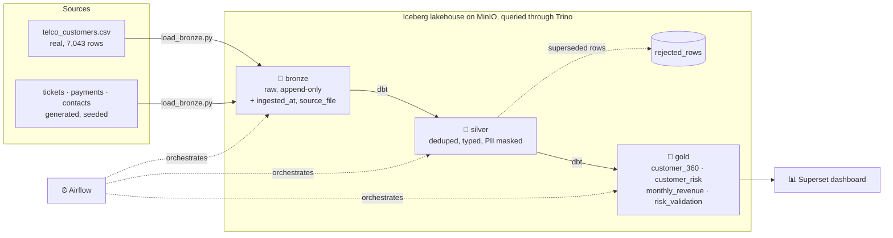

# 🏠 churnhouse

**An end-to-end data lakehouse that predicts which telecom customers will churn, and explains why.**

[](https://github.com/Chaksterr/churnhouse/actions/workflows/ci.yml)


Four CSVs go in. Out come a **tested, versioned Iceberg lakehouse**, a
**Superset dashboard**, and an **Airflow pipeline** that refreshes everything
every night. It all runs on a laptop with Docker, with no cloud account needed.

> **Result:** customers in the *high* risk band churn **83%** of the time, versus
> **12%** in the *low* band (6.7× more). A dbt test fails the build if that ordering ever breaks.

---

## What this project demonstrates

| Area | In this repo |
|---|---|
| **Lakehouse architecture** | Medallion layers (bronze → silver → gold) as Apache Iceberg tables on S3-compatible storage (MinIO), with a REST catalog backed by Postgres |
| **Ingestion** | Custom Python loader using chunked multi-row inserts (about 200× faster than the generic dlt path), append-only, with audit columns |
| **Transformation** | dbt on Trino: deduplication, typing, PII masking, and aggregate-before-join gold models |
| **Data quality** | 35 dbt tests (schema, custom SQL and business-rule tests) plus a quarantine table for rejected rows |
| **Data governance** | Emails and phone numbers masked in silver; tests fail if a raw value leaks |
| **Orchestration** | Airflow 3 DAG with retries, layer-by-layer gating, and a freshness check based on Iceberg snapshots |
| **BI as code** | Superset datasets and dashboard built by API scripts, each chart cross-checked against Trino before saving |
| **CI/CD** | GitHub Actions starts a throwaway lakehouse and runs the full `dbt build` on every push and PR |
| **Reproducibility** | Docker Compose, seeded data generator, locked Python environment (`uv.lock`), one-word `make` targets |

---

## Architecture



| Component | Role |
|---|---|
| **MinIO** | S3-compatible object storage holding the Parquet data files |
| **Iceberg REST catalog + Postgres** | table format and table registry |
| **Trino** | the single SQL engine used by the loader, dbt and Superset |
| **dbt** | silver/gold transformations and tests |
| **Airflow** | scheduling, retries, freshness monitoring |
| **Superset** | dashboard |
| **uv** | Python dependency management |

---

## How churn risk is scored

`customer_risk` adds up five transparent SQL rules (0 to 8 points) and writes a
readable `reasons` column, for example *"month-to-month contract + 2 tickets in 90d"*.
Every score can be explained to a business user.

| Rule | Points |
|---|---|
| Month-to-month contract | +2 |
| Tenure under 6 months | +2 |
| Failed payment in the last 90 days | +2 |
| 2+ support tickets in the last 90 days | +1 |
| Average satisfaction under 3 | +1 |

**Bands:** 🔴 high ≥ 5 · 🟠 medium 3–4 · 🟢 low 0–2

The `risk_validation` table checks the score against real churn outcomes:

| Band | Customers | Churn rate |
|---|---:|---:|
| 🟢 low | ~4,900 | 12.3% |
| 🟠 medium | ~1,600 | 51.3% |
| 🔴 high | 546 | 83.0% |

---

## Data quality and reliability

| Safeguard | What it does |
|---|---|
| **dbt tests (35)** | uniqueness, not-null and accepted values on every key column, plus custom SQL tests for masking and model validity |
| **Business-rule test** | `assert_high_churns_more` fails the build if the high band stops churning more than the low band |
| **Quarantine table** | `silver.rejected_rows` keeps every row that silver drops, with a reason, instead of discarding it silently |
| **Layer gating** | Airflow builds and tests silver before gold, so bad data stops between layers |
| **Retries** | each pipeline task retries twice, 2 minutes apart |
| **Freshness check** | Airflow fails if any gold table's latest Iceberg `$snapshots` commit is older than 24h |
| **CI** | ruff + `dbt parse`, then a full `dbt build` on an empty lakehouse in GitHub Actions |

---

## Quick start

**Prerequisites:** Docker with Compose, [uv](https://docs.astral.sh/uv/), `make`, and the
[IBM Telco Customer Churn dataset](https://www.kaggle.com/datasets/blastchar/telco-customer-churn)
saved as `data/raw/telco_customers.csv` (`data/` is gitignored).

```bash
make setup          # create .env from the template (edit the passwords) + uv sync
make up             # start minio, iceberg catalog, trino, superset
make pipeline       # generate data -> load bronze -> dbt build silver + gold (+ tests)

make superset-init  # first boot only: superset db + admin user
make dashboard      # register gold datasets + build the dashboard

make airflow        # Airflow UI on :8081, Ctrl-C to stop
```

Run `make help` to list every command. Other useful ones: `make docs` (dbt lineage
graph on :8000), `make lint`, `make check` (what CI runs), `make down`, `make nuke` (delete all data).

| Service | URL |
|---|---|
| Superset | http://localhost:8088 |
| Airflow | http://localhost:8081 (password in `orchestration/simple_auth_manager_passwords.json.generated`) |
| Trino | http://localhost:8080 |
| MinIO console | http://localhost:9001 |
| Iceberg REST catalog | http://localhost:8181 |

---

## Project structure

```
churnhouse/
├── generator/generate.py          # seeded synthetic tickets, payments, contacts
├── ingestion/load_bronze.py       # CSV -> bronze loader (chunked inserts, audit columns)
├── dbt/
│   ├── models/silver/             # dedup, typing, PII masking, rejected_rows
│   ├── models/gold/               # customer_360, customer_risk, monthly_revenue, risk_validation
│   ├── models/schema.yml          # schema tests
│   └── tests/                     # custom SQL data tests
├── orchestration/
│   ├── dags/churnhouse_daily.py   # ingest -> silver -> gold -> freshness
│   └── run.sh                     # airflow standalone launcher
├── superset/                      # superset image + dashboard-as-code scripts
├── trino/catalog/                 # trino -> iceberg -> minio wiring
├── docker-compose.yml             # the local lakehouse
├── Makefile                       # one-word commands
└── .github/workflows/ci.yml       # CI pipeline
```

---

## Perspectives

- **Incremental models:** only process new rows on each run instead of rebuilding every silver and gold table.
- **Iceberg maintenance:** a small Airflow DAG that compacts files and expires old snapshots.
- **Failure alerts:** an email or Slack message when a pipeline run or a dbt test fails.
- **Airflow in Docker Compose:** so a single `make up` starts the whole stack.

## Good to know

- The scripts own the dashboard: re-running `make dashboard` overwrites manual edits in Superset.
- Ingestion is append-only and silver deduplicates, so re-running the pipeline is safe. Ticket and payment dates are relative to the run date, so the numbers shift slightly over time.

---

## Author

**Ahmad Chakcha**, final-year Data Engineering student.
Feedback and questions are welcome. Feel free to open an issue.
